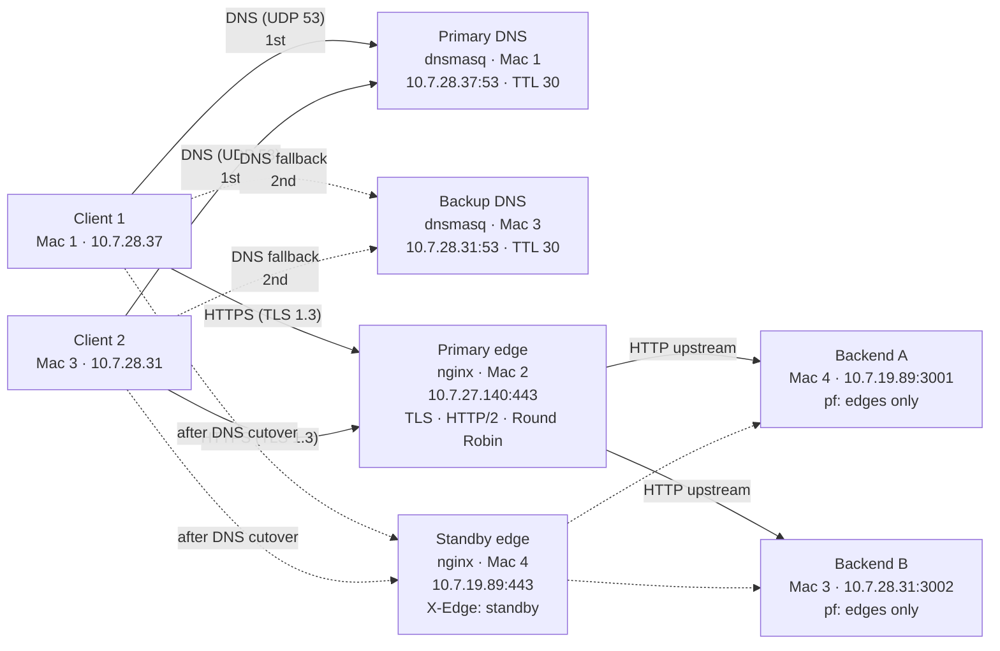

# RouteX — CN Course Project

**Phase 1: Build & Observe · Phase 2: Harden, Recover & Troubleshoot**
**4-Mac topology · hostel Wi-Fi `10.7.0.0/19` · private zone `routex.test`**

## Team (Phase 2)

| Mac | Person | Roles | IP |
|-----|--------|-------|----|
| Mac 1 | **Abhinay (Manikanta)** | Primary DNS (dnsmasq) · Client 1 | `10.7.28.37` |
| Mac 2 | **Junaid** | Nginx Edge · Reverse Proxy · Load Balancer · TLS | `10.7.27.140` |
| Mac 3 | **Srikar** | Backend B `:3002` · Backup DNS · pf firewall · Client 2 · Wireshark | `10.7.28.31` |
| Mac 4 | **Nachiket** | Backend A `:3001` · Standby edge · pf firewall | `10.7.19.89` |

> IPs are from the Phase 2 test day (22 Nov 2026). DHCP can change them; see [If an IP changes](#if-an-ip-changes-dhcp-drift).
> Phase 1 ran on 3 Macs with different IPs. See the [note on Mac 4](#note-mac-4-and-the-phase-1--phase-2-change) at the end.

## Architecture (Phase 2)



## Request Path

```
Client → DNS (Mac 1:53, fallback Mac 3:53) → edge (Mac 2:443) → nginx LB → Backend A (Mac 4) or B (Mac 3)
```

> `app.routex.test` and `api.routex.test` both resolve to the edge (`10.7.27.140`) with a 30 s TTL.
> The edge terminates TLS and round-robins to the backends over plain HTTP. If one backend fails, nginx retries on the other.

## Phase 1 Progress

Full write-up: [`docs/PROJECT-REPORT.md` → Part 1](docs/PROJECT-REPORT.md#part-1--phase-1-build--observe)

- [x] **A**: Private LAN: IPs pinned, ping matrix, topology diagram
- [x] **B**: Private DNS (dnsmasq on Mac 1), clients pointed at it
- [x] **C**: Two backend services (A on Mac 1:3001, B on Mac 3:3002)
- [x] **D**: nginx reverse proxy + round-robin load balancer (Mac 2)
- [x] **E**: HTTPS/TLS at the edge: SAN cert, trusted on clients
- [x] **F**: HTTP caching: `Cache-Control: max-age=60`, `ETag`, 304
- [x] **G**: Wireshark captures (DNS, TCP, TLS, HTTP, LB alternation)
- [x] **Failures 1–5**: five required failure demonstrations

## Phase 2 Progress

Full write-up for both phases: [`docs/PROJECT-REPORT.md`](docs/PROJECT-REPORT.md)

- [x] **Rebuild**: 4-Mac layout, Backend A moved to Mac 4, new cert with `app` + `api` in the SAN
- [x] **Ext A**: Backup DNS on Mac 3; Mac 1 stopped → `SERVER: 10.7.28.31#53` still answers
- [x] **Ext B**: TTL 30 visible in `dig`; cached client kept the old IP until expiry, then switched
- [~] **Ext C**: pf isolation: `:3002` on Mac 3 blocked from clients and allowed from the edge, rollback shown. *Mac 4 `:3001` still to re-capture.*
- [x] **Ext D**: HA failover: either backend stopped → every request served by the other; `X-Upstream` shows the retry
- [x] **Ext E**: Standby edge on Mac 4, tested with `curl --resolve`, DNS cutover primary → standby
- [x] **Ext F**: Troubleshooting ladder (Link → DNS → TCP → TLS → App), wrong-A-record fault diagnosed

**Still to capture / commit:** R01–R03 rebuild screenshots · A03 · B flush · C01/C02 on Mac 4 · D balanced-after + error log · E03 · F02. Running configs from the other Macs: `dns/dnsmasq.conf` (Mac 1), `dns/dnsmasq-backup.conf` + `firewall/pf-mac3.conf` (Mac 3), `nginx/nginx-standby.conf` + `firewall/pf-mac4.conf` (Mac 4).

## Repository Structure

```
backend-a/          serverA.js (Express, port 3001, X-Backend: A, /api/info, /health)
backend-b/          serverB.js (Express, port 3002, X-Backend: B, /api/info, /health)
phase1/             dnsmasq.conf, nginx.conf (Phase 1 configs, kept unchanged)
nginx/              nginx.conf (Phase 2 primary edge, Mac 2) · nginx-standby.conf (Mac 4)
dns/                dnsmasq.conf (primary, Mac 1) · dnsmasq-backup.conf (Mac 3)
firewall/           pf-mac3.conf · pf-mac4.conf (backend isolation rules)
tls/                app.routex.test.crt (SAN: app + api; key is gitignored)
config/             (reserved)
docs/
  IP-INVENTORY.md   all Macs, ports, reachability after pf
  TOPOLOGY.md       diagrams for Phase 1 and Phase 2
  COMMAND-LOG.md    every command, Phase 1 and Phase 2
  PROJECT-REPORT.md full report: Phase 1 (build) + Phase 2 (harden)
evidence/
  01-lan/ … 08-failures/       Phase 1 screenshots and captures
  09-phase2/
    00-rebuild/                R01–R03
    A-backup-dns/              A01–A03
    B-ttl/                     B01–B03
    C-isolation/               C01–C04
    D-failover/                D01–D04
    E-cutover/                 E01–E03
    F-troubleshooting/         F01-<Mac>-<fault>-symptom, F02-…-fixed
```

## If an IP Changes (DHCP drift)

Each IP appears in four places. Update all of them together:
1. **DNS records** on Mac 1 **and** Mac 3: `listen-address` + `address=` lines → `sudo brew services restart dnsmasq`
2. **nginx upstream** on Mac 2 **and** Mac 4 → `sudo nginx -t && sudo nginx -s reload`
3. **pf `<edges>` table** on Mac 3 and Mac 4 → `sudo pfctl -f /etc/pf.routex.conf`
4. **Client resolver list** on every Mac → `sudo networksetup -setdnsservers Wi-Fi <Mac1> <Mac3>`

Then re-test bottom-up: `dig app.routex.test` → `nc -vz app.routex.test 443` → `curl https://app.routex.test/api/status`.

## Marks

| Review | Area | Marks |
|--------|------|:-----:|
| 1 | LAN + private DNS (A + B) | 10 |
| 1 | Backends + reverse proxy + load balancing (C + D) | 10 |
| 1 | HTTPS / TLS (E) | 8 |
| 1 | Packet analysis (G) | 7 |
| 1 | HTTP caching + transport (F) | 5 |
| 1 | Individual viva | 10 |
| 2 | Resilience + HA failover (Ext A, B, D) | 15 |
| 2 | Service isolation + edge migration (Ext C, E) | 10 |
| 2 | Troubleshooting challenge (Ext F) | 10 |
| 2 | Final report + documentation | 5 |
| 2 | Individual viva | 10 |
| | **Total** | **100** |

> `*.key` is gitignored. The private key is moved between Macs by AirDrop only and is never committed.

---

## Note: Mac 4 and the Phase 1 → Phase 2 change

**Phase 1 ran on 3 Macs because Mac 4 was damaged.** The PDF's layout puts Backend A and Backend B on separate machines, but with Mac 4 out of action we doubled up: Mac 1 ran **both** the DNS server and Backend A.

| Phase 1 (3 Macs) | IP | Roles |
|------------------|----|-------|
| Mac 1 · Abhinay | `10.7.17.157` | DNS server · Backend A `:3001` · Client 1 |
| Mac 2 · Junaid | `10.7.17.8` | nginx edge · TLS · load balancer |
| Mac 3 · Srikar | `10.7.17.37` | Backend B `:3002` · Client 2 · Wireshark |
| Mac 4 | | *damaged, not used* |

**What we changed for Phase 2, once Mac 4 was back:**
- **Backend A moved from Mac 1 to Mac 4** (`10.7.19.89:3001`). This was the only role that moved. With DNS and Backend A on one machine, stopping one looked like the other failing. Separating them makes the DNS-failure and app-failure tests clean.
- **Mac 4 also became the standby edge** (Ext E) and runs a pf firewall for its backend (Ext C).
- **Mac 3 picked up the backup DNS server** (Ext A) and a pf firewall for Backend B.
- **Clients needed no change.** They only know `app.routex.test`, and nginx holds the backend list, so moving a backend only meant editing the upstream block on the edge.
- **DHCP gave every Mac a new IP**, so DNS records, the nginx upstream, pf tables and client resolver lists were all updated (Phase 1 → Phase 2: Mac 1 `.17.157 → .28.37`, Mac 2 `.17.8 → .27.140`, Mac 3 `.17.37 → .28.31`).

The Phase 1 configs are kept unchanged in `phase1/`, and the Phase 1 evidence in `evidence/01-lan … 08-failures`, so the evaluator can compare the two phases directly.
