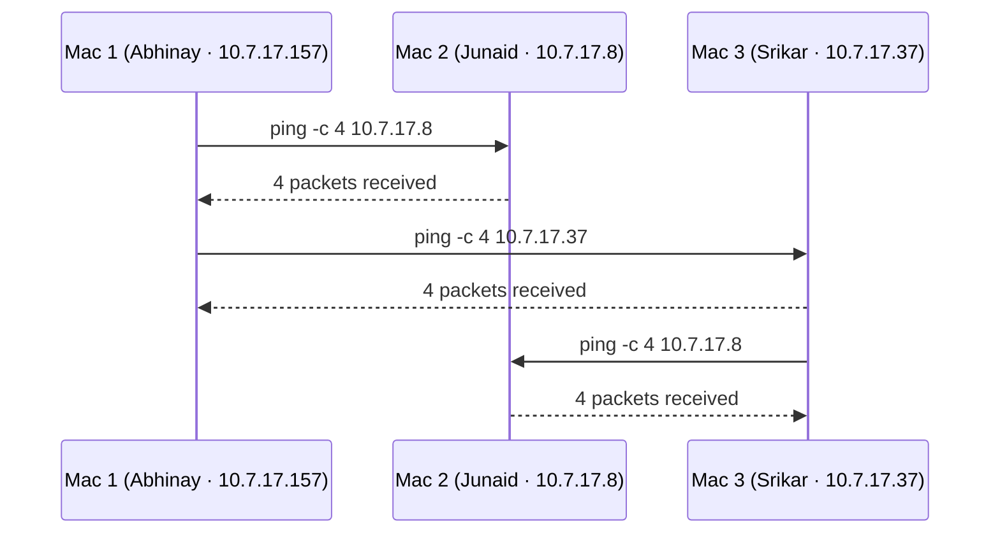
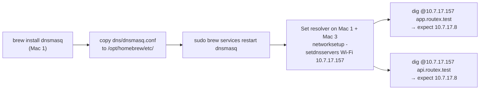
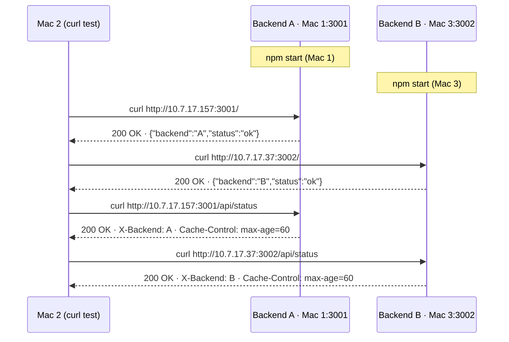
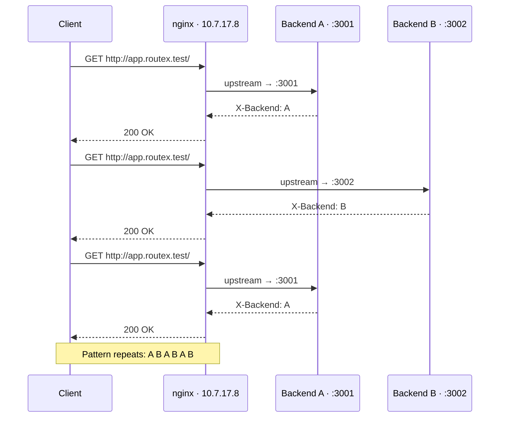
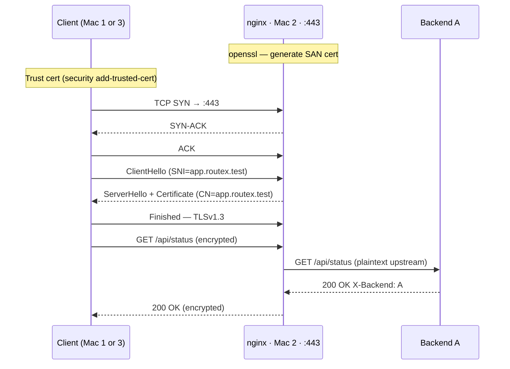
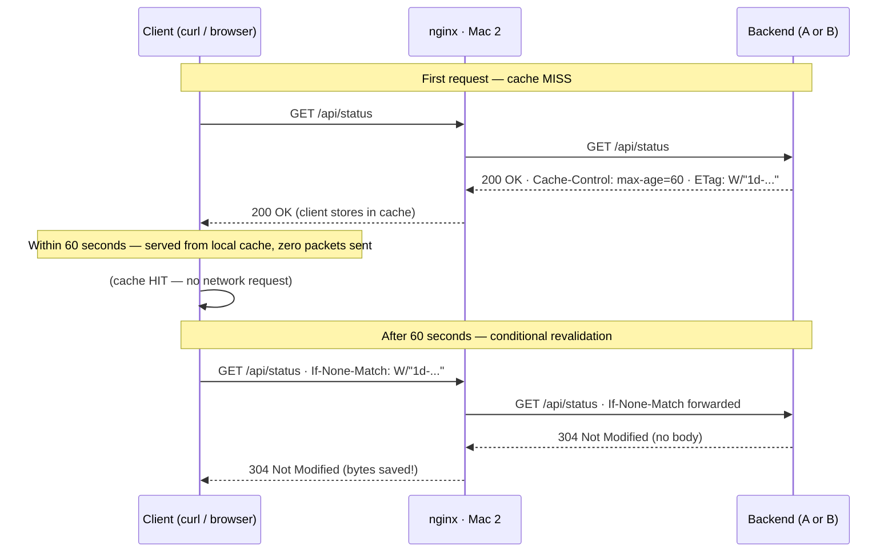
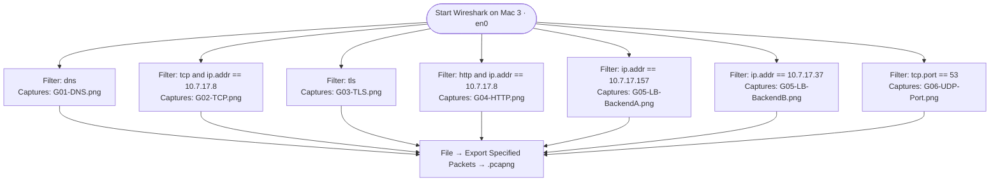
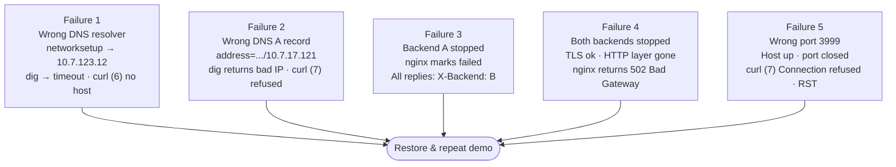
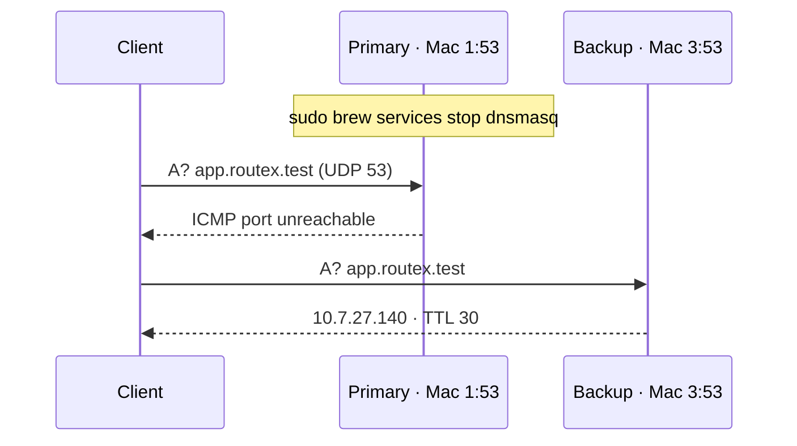

# Command Log — RouteX (Phase 1 + Phase 2)

---

## Task A — Verify LAN Connectivity



```bash
# On each Mac — confirm assigned IP
ipconfig getifaddr en0

# Ping matrix — run from each Mac
ping -c 4 10.7.17.157   # Mac 1
ping -c 4 10.7.17.8     # Mac 2
ping -c 4 10.7.17.37    # Mac 3
```

---

## Task B — DNS Server



```bash
brew install dnsmasq
sudo cp dns/dnsmasq.conf /opt/homebrew/etc/dnsmasq.conf
sudo brew services restart dnsmasq

# Set resolver (Mac 1 AND Mac 3)
sudo networksetup -setdnsservers Wi-Fi 10.7.17.157

dig @10.7.17.157 app.routex.test   # → 10.7.17.8
dig @10.7.17.157 api.routex.test   # → 10.7.17.8
dig +short app.routex.test
```

---

## Task C — Backend Services



```bash
# Mac 1 — Backend A
cd backend-a && npm start

# Mac 3 — Backend B
cd backend-b && npm start

# Test from Mac 2
curl -s http://10.7.17.157:3001/
curl -s http://10.7.17.157:3001/api/status
curl -s http://10.7.17.37:3002/
curl -s http://10.7.17.37:3002/api/status
```

---

## Task D — Nginx Load Balancer



```bash
brew install nginx
sudo cp nginx/nginx.conf /opt/homebrew/etc/nginx/nginx.conf

nginx -t                    # must say: syntax is ok
sudo nginx
# or reload:
sudo nginx -s reload

# Prove round robin (6 requests → A B A B A B)
for i in 1 2 3 4 5 6; do
  curl -s http://app.routex.test/ | grep -o '"backend":"."'
done
```

---

## Task E — TLS / HTTPS



```bash
# Mac 2 — generate SAN cert
openssl req -x509 -newkey rsa:2048 -days 365 -nodes \
  -keyout tls/app.routex.test.key \
  -out    tls/app.routex.test.crt \
  -subj   "/CN=app.routex.test" \
  -addext "subjectAltName=DNS:app.routex.test,DNS:api.routex.test"

# Mac 1 + Mac 3 — trust the cert
sudo security add-trusted-cert -d -r trustRoot \
  -k /Library/Keychains/System.keychain app.routex.test.crt

# Test (no -k needed after trusting)
curl -v https://app.routex.test/api/status

# Verify TLS details
openssl s_client -connect app.routex.test:443 -servername app.routex.test < /dev/null
```

---

## Task F — HTTP Caching



```bash
# First request — see Cache-Control and ETag
curl -I https://app.routex.test/api/status

# Conditional GET — revalidation (304)
ETAG=$(curl -sI https://app.routex.test/api/status \
  | grep -i etag | awk '{print $2}' | tr -d '\r')
curl -I -H "If-None-Match: $ETAG" https://app.routex.test/api/status
# expect: HTTP/1.1 304 Not Modified
```

---

## Task G — Wireshark Captures



---

## Failures — Required Demonstrations



```bash
# Failure 1 — wrong resolver
sudo networksetup -setdnsservers Wi-Fi 10.7.123.12
dig app.routex.test           # timed out
curl -v https://app.routex.test/api/status  # curl (6)
sudo networksetup -setdnsservers Wi-Fi 10.7.17.157   # RESTORE

# Failure 2 — wrong A record (edit dnsmasq.conf → 10.7.17.121, restart)
dig +short app.routex.test    # 10.7.17.121 (wrong)
curl -v https://app.routex.test/api/status  # curl (7)
# RESTORE: fix dnsmasq.conf, brew services restart dnsmasq

# Failure 3 — stop Backend A (Ctrl+C on Mac 1)
curl https://app.routex.test/api/status  # X-Backend: B every time

# Failure 4 — stop both backends
curl -v https://app.routex.test/api/status  # 502 Bad Gateway

# Failure 5 — wrong port
curl -v http://10.7.17.37:3999/api/status  # curl (7) Connection refused
```

---
---

# Phase 2 — Harden, Recover & Troubleshoot

> 4 Macs. Mac 4 was damaged in Phase 1; in Phase 2 it runs Backend A (moved from Mac 1) and the standby edge.
> IPs: Mac 1 `10.7.28.37` · Mac 2 `10.7.27.140` · Mac 3 `10.7.28.31` · Mac 4 `10.7.19.89`

## Rebuild — Phase 1 on 4 Macs

```bash
# Every Mac: record IP / mask / gateway / MAC, then check reachability
networksetup -getinfo "Wi-Fi"
ifconfig en0 | grep ether
for ip in 10.7.28.37 10.7.27.140 10.7.28.31 10.7.19.89; do ping -c2 -t2 $ip >/dev/null && echo "$ip ok" || echo "$ip FAIL"; done

# Mac 1: primary DNS
sudo tee "$(brew --prefix)/etc/dnsmasq.conf" >/dev/null <<'CONF'
listen-address=127.0.0.1,10.7.28.37
bind-interfaces
domain-needed
bogus-priv
local=/routex.test/
address=/app.routex.test/10.7.27.140
address=/api.routex.test/10.7.27.140
local-ttl=30
log-queries
log-facility=/tmp/dnsmasq.log
CONF
sudo brew services restart dnsmasq

# Mac 4: Backend A    ·    Mac 3: Backend B
cd backend-a && npm install && npm start
cd backend-b && npm install && npm start

# Mac 2: new cert with BOTH names + serverAuth
openssl req -x509 -newkey rsa:2048 -days 365 -nodes -sha256 \
  -keyout tls/app.routex.test.key -out tls/app.routex.test.crt \
  -subj "/CN=app.routex.test" \
  -addext "subjectAltName=DNS:app.routex.test,DNS:api.routex.test" \
  -addext "extendedKeyUsage=serverAuth"

# Every client: replace the old trusted cert
sudo security delete-certificate -c app.routex.test /Library/Keychains/System.keychain
sudo security add-trusted-cert -d -r trustRoot -k /Library/Keychains/System.keychain app.routex.test.crt

# Mac 2: edge config = nginx/nginx.conf in this repo
sudo nginx -t && (sudo nginx -s reload || sudo nginx)

# Every Mac: both DNS servers, primary first
sudo networksetup -setdnsservers "Wi-Fi" 10.7.28.37 10.7.28.31
sudo dscacheutil -flushcache; sudo killall -HUP mDNSResponder
```

> **Gotcha (Mac 2):** pasting a heredoc into zsh can turn `proxy_pass http://project_backends;` into `project_backends\;` (zsh's URL-quoting on paste). `nginx -t` then fails with *invalid number of arguments in "proxy_pass"* and the **old config keeps running**. Run `unset zle_bracketed_paste` first, or edit with `sudo nano`. Relative `tls/…` cert paths resolve to `$(brew --prefix)/etc/nginx/tls/`, so that folder must exist.

---

## Ext A — Backup DNS (Mac 3)



```bash
# Mac 3: same file as Mac 1, listening on 10.7.28.31
#   listen-address=127.0.0.1,10.7.28.31   (rest identical)
sudo brew services restart dnsmasq
dig @10.7.28.31 app.routex.test +short       # 10.7.27.140

# Client: confirm both resolvers
scutil --dns | grep nameserver | head -2

# Break the primary (Mac 1)
sudo brew services stop dnsmasq
# Client
sudo dscacheutil -flushcache; sudo killall -HUP mDNSResponder
dig app.routex.test                          # SERVER: 10.7.28.31#53
curl -s https://app.routex.test/api/status   # still works by name

# Restore (Mac 1)
sudo brew services start dnsmasq
```

---

## Ext B — TTL and controlled record change

```bash
dig +noall +answer api.routex.test           # api.routex.test. 30 IN A 10.7.27.140

# Client: watch the cached answer
while true; do echo "$(date +%T) $(ping -c1 -t1 api.routex.test 2>/dev/null | head -1)"; sleep 5; done

# Mac 1 AND Mac 3: point api at Mac 4
sudo sed -i '' 's#^address=/api.routex.test/.*#address=/api.routex.test/10.7.19.89#' "$(brew --prefix)/etc/dnsmasq.conf"
sudo brew services restart dnsmasq
#   dig shows 10.7.19.89 at once; ping loop switches only when the TTL expires

# Restore on both, then flush the client: switch is immediate
sudo sed -i '' 's#^address=/api.routex.test/.*#address=/api.routex.test/10.7.27.140#' "$(brew --prefix)/etc/dnsmasq.conf"
sudo brew services restart dnsmasq
sudo dscacheutil -flushcache; sudo killall -HUP mDNSResponder
```

---

## Ext C — Backend isolation with pf (Mac 3 and Mac 4)

```bash
sudo pfctl -s info | head -1                 # write down Enabled / Disabled
cp /etc/pf.conf ~/pf.conf.rollback           # rollback copy

# Mac 3 (port 3002); Mac 4 uses the same file with port 3001
sudo tee /etc/pf.routex.conf >/dev/null <<'CONF'
set skip on lo0
table <edges> { 10.7.27.140, 10.7.19.89 }
pass  in quick proto tcp from <edges> to any port 3002
block in quick proto tcp from any     to any port 3002
CONF
sudo pfctl -nf /etc/pf.routex.conf           # syntax check only
sudo pfctl -f  /etc/pf.routex.conf
sudo pfctl -e
sudo pfctl -sr

# Mac 1 (client): blocked
nc -vz -G 3 10.7.19.89 3001                  # timed out
nc -vz -G 3 10.7.28.31 3002                  # timed out
ping -c2 10.7.19.89                          # host still up
curl -s https://app.routex.test/api/status   # 200 through the edge

# Mac 2 (edge): allowed
nc -vz 10.7.19.89 3001                       # succeeded
nc -vz 10.7.28.31 3002                       # succeeded
```

**Rollback (Mac 3 and Mac 4):**
```bash
sudo pfctl -f /etc/pf.conf                   # original rules back
sudo pfctl -d                                # only if it was "Disabled" before
sudo pfctl -s info | head -1                 # matches what you wrote down
nc -vz -G 3 10.7.19.89 3001                  # from Mac 1: succeeds again
```

---

## Ext D — HA failover

```bash
# Mac 2: watch the log
tail -f "$(brew --prefix)/var/log/nginx/error.log"

# Client: 10 requests, show which backend answered and which were tried
for i in $(seq 1 10); do curl -s -o /dev/null -D - https://app.routex.test/api/status \
  | grep -iE "x-backend|x-upstream" | tr '\r\n' '  '; echo; sleep 1; done

# Mac 4: Ctrl+C Backend A → every line X-Backend: B,
#   some with X-Upstream: 10.7.19.89:3001, 10.7.28.31:3002 (retry)
# Mac 4: npm start → after fail_timeout (10 s) A and B alternate again
```

---

## Ext E — Standby edge and DNS cutover (Mac 4)

```bash
# Mac 4: same nginx.conf as Mac 2, except
#   add_header X-Edge standby always;
sudo nginx -t && (sudo nginx -s reload || sudo nginx)

# Test the standby without touching DNS
curl -sI --resolve app.routex.test:443:10.7.19.89 https://app.routex.test/api/status | grep -iE "HTTP|x-edge|x-backend"
#   HTTP/2 200 · x-edge: standby

# Clients: watch which edge answers
while true; do echo "$(date +%T) $(curl -s -o /dev/null -D - https://app.routex.test/api/status | grep -i x-edge | tr -d '\r')"; sleep 3; done

# Mac 1 AND Mac 3: cut over
sudo sed -i '' 's#^address=/app.routex.test/.*#address=/app.routex.test/10.7.19.89#' "$(brew --prefix)/etc/dnsmasq.conf"
sudo brew services restart dnsmasq
#   cached client: primary … until TTL → standby ; flushed client: standby at once

# Rollback: same sed with 10.7.27.140
```

---

## Ext F — Troubleshooting ladder (bottom-up)

```bash
# 1 LINK / IP
ipconfig getifaddr en0 ; ping -c2 10.7.27.140
# 2 DNS
scutil --dns | grep nameserver | head -3
dig app.routex.test ; dig @10.7.28.37 app.routex.test +short ; dig @10.7.28.31 app.routex.test +short
grep routex.test /etc/hosts               # dig ignores /etc/hosts, curl uses it
# 3 TCP
nc -vz -G 3 app.routex.test 443
sudo lsof -nP -iTCP -sTCP:LISTEN          # on the server
# 4 TLS
openssl s_client -connect app.routex.test:443 -servername app.routex.test </dev/null 2>/dev/null | grep -E "subject=|issuer=|Verify return"
curl -v https://app.routex.test/api/status 2>&1 | grep -iE "ssl|certificate|expire"
# 5 HTTP / APP
curl -si https://app.routex.test/api/status | head -8 ; echo "curl exit: $?"
tail -20 "$(brew --prefix)/var/log/nginx/error.log"                            # Mac 2
curl -s http://10.7.19.89:3001/health ; curl -s http://10.7.28.31:3002/health   # from Mac 2
```

| Signal | Layer |
|--------|-------|
| curl exit 6 | DNS: could not resolve host |
| curl exit 7 | TCP: connection refused |
| curl exit 28 | Timeout: packets dropped (firewall / host gone) |
| curl exit 35 / 60 | TLS: handshake / certificate |
| 502 | Backend refused or down |
| 504 | Backend did not answer in time |
