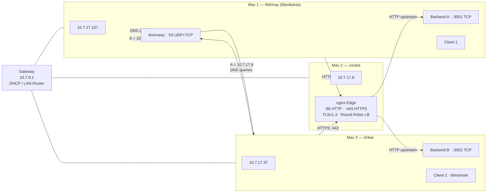
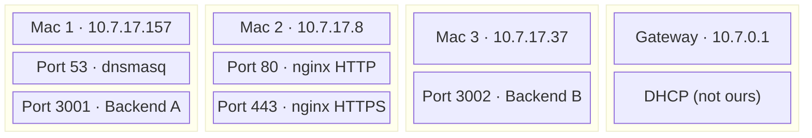
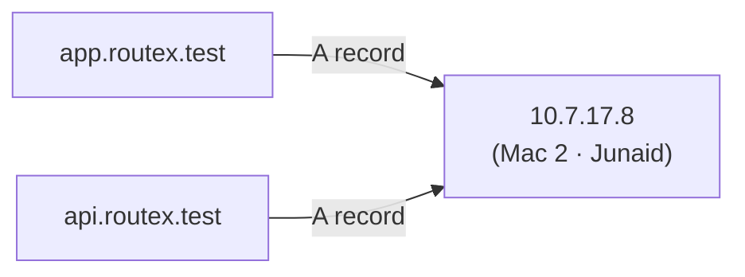
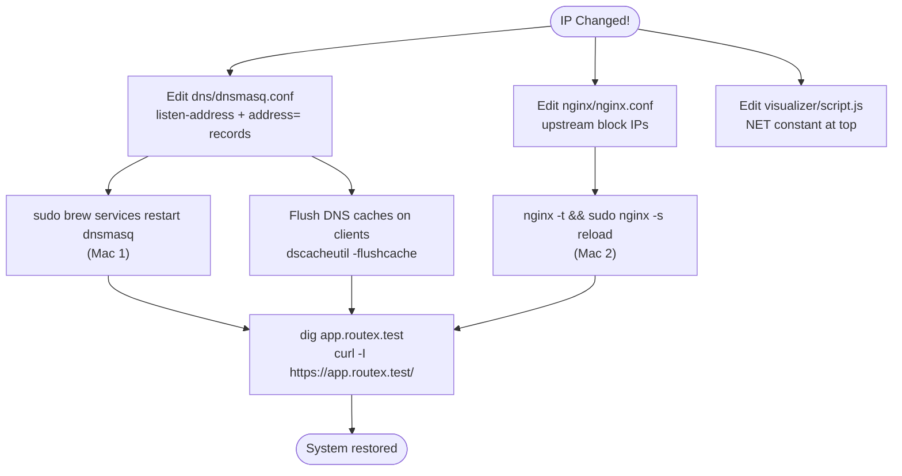
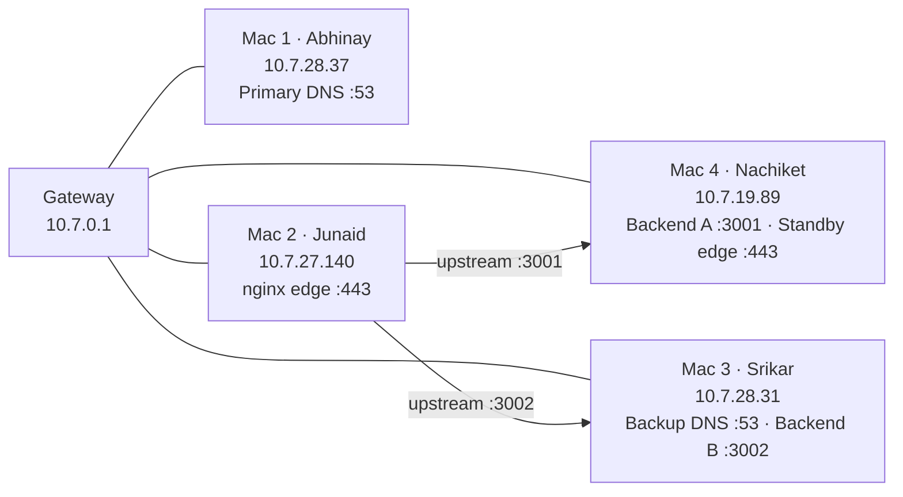

# IP Inventory — RouteX (Phase 1 + Phase 2)

> Jump to [Phase 2](#phase-2--4-macs) for the current 4-Mac addresses.

## Network Map

---

## Port Table

---

## DNS Records

---

## IP Change Protocol

---

# Phase 2 — 4 Macs

> Phase 1 (above) ran on 3 Macs because Mac 4 was damaged. In Phase 2 Mac 4 rejoined and Backend A moved from Mac 1 to Mac 4. DHCP also gave every Mac a new address.

Subnet `10.7.0.0/19` (mask `255.255.224.0`) · Gateway `10.7.0.1` · Interface `en0` (Wi-Fi)

| Mac | Person | Phase 1 IP | Phase 2 IP | Listening ports (Phase 2) |
|-----|--------|-----------|-----------|---------------------------|
| Mac 1 | Abhinay | `10.7.17.157` | `10.7.28.37` | 53 UDP/TCP (primary dnsmasq) |
| Mac 2 | Junaid | `10.7.17.8` | `10.7.27.140` | 80, 443 (nginx primary edge) |
| Mac 3 | Srikar | `10.7.17.37` | `10.7.28.31` | 53 UDP/TCP (backup dnsmasq), 3002 (Backend B) |
| Mac 4 | Nachiket | not used (damaged) | `10.7.19.89` | 3001 (Backend A), 80/443 (standby nginx) |

## Who can reach which port (with pf loaded)

| From ↓ / To → | Mac 1 :53 | Mac 2 :443 | Mac 3 :53 | Mac 3 :3002 | Mac 4 :3001 | Mac 4 :443 |
|---------------|:---------:|:----------:|:---------:|:-----------:|:-----------:|:----------:|
| Any client (Mac 1 / Mac 3) | ✅ | ✅ | ✅ | ❌ timeout | ❌ timeout | ✅ |
| Mac 2 (edge) | ✅ | n/a | ✅ | ✅ | ✅ | ✅ |
| Mac 4 (standby edge) | ✅ | ✅ | ✅ | ✅ | n/a | n/a |

pf table on both backends: `table <edges> { 10.7.27.140, 10.7.19.89 }`. Everything else to 3001/3002 is dropped silently, so clients see a timeout, not "refused".

## Phase 2 Network Map

## Phase 2 IP Change Protocol

An IP appears in four places. Update them together:

1. `address=` / `listen-address` in dnsmasq on **Mac 1 and Mac 3** → `sudo brew services restart dnsmasq`
2. `upstream` block in nginx on **Mac 2 and Mac 4** → `sudo nginx -t && sudo nginx -s reload`
3. `<edges>` table in `/etc/pf.routex.conf` on **Mac 3 and Mac 4** → `sudo pfctl -f /etc/pf.routex.conf`
4. Resolver list on every Mac → `sudo networksetup -setdnsservers Wi-Fi 10.7.28.37 10.7.28.31`

Then flush (`sudo dscacheutil -flushcache; sudo killall -HUP mDNSResponder`) and re-test: `dig` → `nc -vz … 443` → `curl`.
