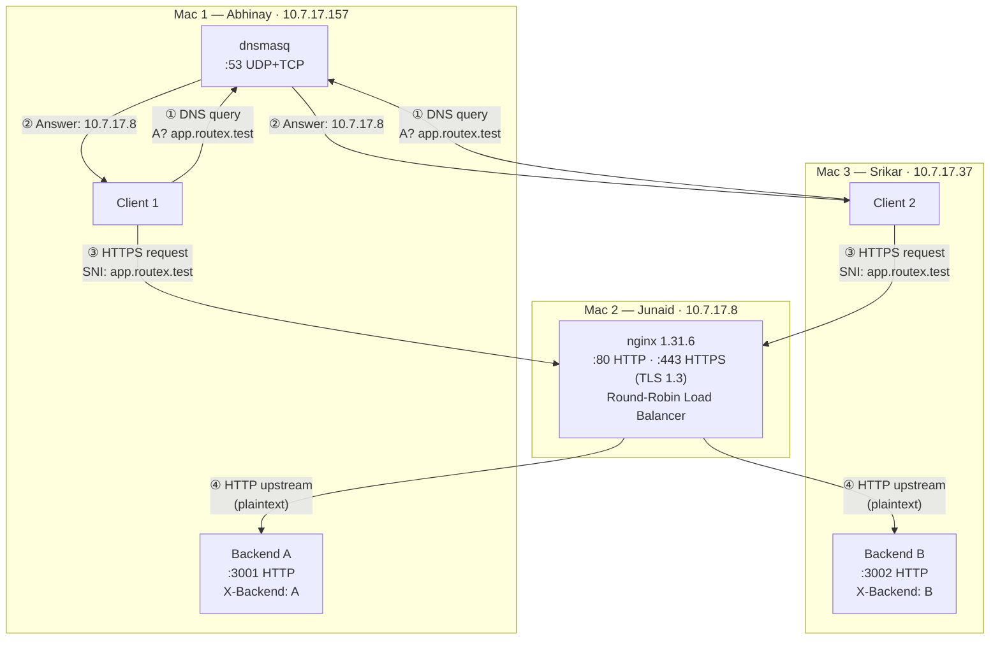
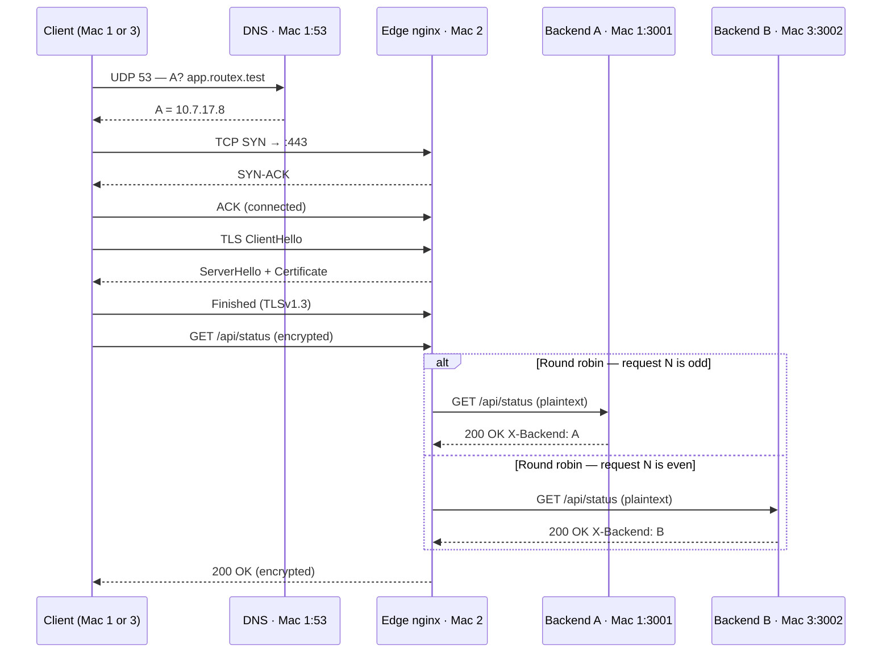
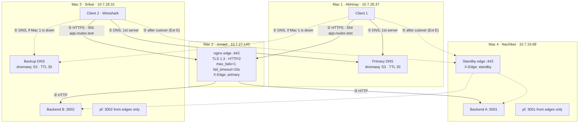
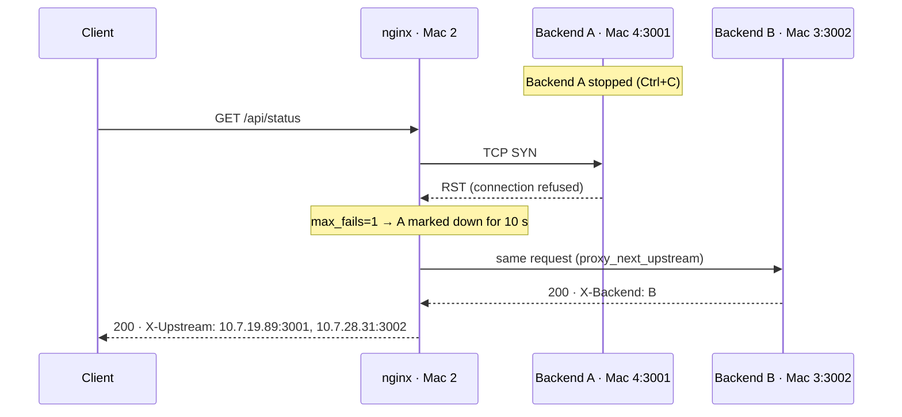

# Network Topology — RouteX (Phase 1 + Phase 2)

> Phase 1 (below) ran on 3 Macs because Mac 4 was damaged. Jump to [Phase 2](#phase-2--4-mac-topology) for the current layout.

## Phase 1 Team (3 Macs)

| Mac | Person | Role(s) | IP Address |
|-----|--------|---------|------------|
| Mac 1 | **Abhinay (Manikanta)** | DNS Server (dnsmasq) · Backend A · Client 1 | `10.7.17.157` |
| Mac 2 | **Junaid** | Nginx Edge · Reverse Proxy · Load Balancer · TLS | `10.7.17.8` |
| Mac 3 | **Srikar** | Backend B · Client 2 · Wireshark capture | `10.7.17.37` |

Network: `10.7.0.0/19` · Gateway: `10.7.0.1`

---

## Architecture Diagram



---

## Request Flow (Step by Step)



---

## DNS Records (`dns/dnsmasq.conf` on Mac 1)

```
address=/app.routex.test/10.7.17.8
address=/api.routex.test/10.7.17.8
```

Both names point at the **edge** (Mac 2). Clients never use a backend IP.

---

## Required Requests Per Task (Evidence Checklist)

| Task | Min. Requests | Goal | Command |
|------|:---:|-------|---------|
| **Task B** – DNS works | 2 | One `dig` per client (Manikanta + Srikar) | `dig @10.7.17.157 app.routex.test` |
| **Task C** – Backends respond | 2 | Hit Backend A (`:3001`) and Backend B (`:3002`) directly | `curl http://10.7.17.157:3001/` |
| **Task D** – Load Balancer alternates | **6** | 3 rounds of Round Robin: A→B→A→B→A→B | `curl http://app.routex.test/` (×6) |
| **Task E** – TLS works | 2 | One HTTPS request each from Manikanta + Srikar | `curl https://app.routex.test/` |
| **Task F** – Cache-Control | 4 | Hit `/api/status` twice — 1st miss (200), 2nd revalidation (304) | `curl -I https://app.routex.test/api/status` |
| **Task G** – Wireshark capture | 1+ | Capture during any of the above; export as `.pcapng` | Wireshark on `en0` |

> **Minimum total requests to send: ~17**
> Capture at least one session per protocol: DNS/UDP, TCP handshake, TLS, HTTP.

---

## Phase 2 — 4-Mac Topology

Mac 4 is back, so Phase 2 follows the PDF's 4-machine layout. **Backend A is the only role that moved: from Mac 1 to Mac 4.** That separates the DNS server from the backends, so a DNS failure and an application failure can be tested on their own.

| Mac | Person | Role(s) | IP Address |
|-----|--------|---------|------------|
| Mac 1 | **Abhinay (Manikanta)** | Primary DNS (dnsmasq) · Client 1 | `10.7.28.37` |
| Mac 2 | **Junaid** | Primary edge: nginx · TLS · load balancer | `10.7.27.140` |
| Mac 3 | **Srikar** | Backend B `:3002` · Backup DNS · pf · Client 2 · Wireshark | `10.7.28.31` |
| Mac 4 | **Nachiket** | Backend A `:3001` · Standby edge · pf | `10.7.19.89` |

Network: `10.7.0.0/19` · Gateway: `10.7.0.1`

| Role | Cloud equivalent |
|------|------------------|
| dnsmasq primary + backup | Route 53 (multiple name servers) |
| nginx edge (Mac 2) | AWS Application Load Balancer |
| Standby edge (Mac 4) | Blue-green target for a DNS cutover |
| Backend A / B | Two EC2 app instances in a target group |
| pf `<edges>` allow-list | Security group: allow inbound only from the LB |



### Failover request flow (Ext D)



### Single points of failure

| Component | Redundant? | How it fails over |
|-----------|------------|-------------------|
| Backends | Yes (A + B) | Automatic: nginx passive health checks + retry (Ext D) |
| DNS | Yes (Mac 1 + Mac 3) | Client tries the next resolver (Ext A) |
| Edge | Standby only | Manual DNS cutover, delayed by the TTL (Ext E) |
| Wi-Fi router | **No** | Still a single point of failure |

Full edge HA would need a floating virtual IP (VRRP/keepalived), health-checked DNS, or a managed multi-zone load balancer.

### DNS records (Phase 2, both DNS servers)

```
address=/app.routex.test/10.7.27.140
address=/api.routex.test/10.7.27.140
local-ttl=30
```
